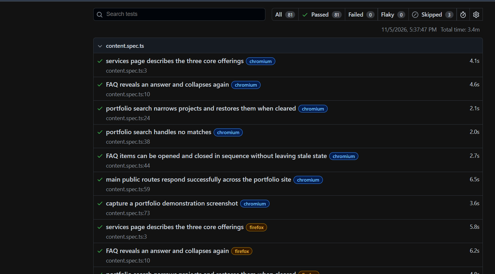

# MTech Corp — Playwright Automation

A TypeScript end-to-end testing project for [MTech Corp Jamaica](https://mtechcorpja.com), built as a QA automation portfolio piece. It tests how visitors discover services, browse projects, use FAQs, and receive enquiry-form validation feedback.

## Test results

The supplied Playwright report screenshot shows **81 passed, 0 failed, 0 flaky, and 3 skipped** in **3.4 minutes** on November 5, 2026. The three skipped cases correspond to the mobile-only scenario on desktop browser profiles.



The screenshot records a local run; GitHub Actions results are available on the repository's [Actions tab](https://github.com/Moya876/mtech-playwright-automation/actions).

## Run locally

Install Node.js 24 LTS, then run:

```sh
npm ci
npx playwright install
npm test
npm run report
```

For a quick run or interactive demonstration:

```sh
npm run test:chromium
npm run test:headed
npm run test:ui
```

On Linux, install browser system dependencies with `npx playwright install --with-deps`.

## Coverage

| Area | Checks |
| --- | --- |
| Homepage | HTTP response, title, hero content, primary link targets |
| Navigation | Services, About, Portfolio, Contact, and Quote destinations |
| Mobile | Menu navigation and menu dismissal after selecting a destination |
| Responsive layout | No horizontal page overflow on five primary pages |
| Services | Visibility of the three core service offerings |
| FAQ | Answer content, expanded state, and collapse behavior |
| Portfolio | Matching search, cleared search, and no-results feedback |
| Contact | Four required-field validation errors |
| Quote | Required-field errors, invalid email, and retained service selection |
| Contact links | Email and telephone hrefs without launching external applications |
| Report evidence | Homepage screenshot attachment for each browser project |

There are 21 scenarios per project across desktop Chromium, Firefox, WebKit, and a Pixel 7 mobile Chromium profile (84 scheduled cases). One mobile-only scenario skips the three desktop profiles. Mobile coverage uses browser emulation, not a physical device. WebKit coverage is not a test on the Safari application itself.

## Run evidence

The screenshot above documents the expanded 21-scenario suite: 84 scheduled cases, with 81 passed and 3 skipped. The original 16-scenario suite also passed all 64 executions against the live site with Playwright 1.64.1 on November 5, 2026. TypeScript validation (`npx tsc --noEmit`) passed during project setup. Results describe the recorded runs; the live site's behavior can change.

## Design choices

- Role, label, and placeholder locators follow the rendered site instead of generated CSS classes.
- Playwright assertions wait for the required state; there are no fixed sleeps.
- Each test gets an isolated browser context and can run independently.
- Two workers limit concurrent traffic to the public site.
- `tests/fixtures.ts` blocks all requests except GET, HEAD, and OPTIONS. Service workers are disabled so they cannot bypass that routing guard. Form scenarios cover invalid input and corrections; outgoing write requests remain blocked, so these tests do not establish backend delivery. The guard also blocks analytics POSTs, so this suite does not represent an entirely unrestricted production session.
- Failure reports retain screenshots, video, and Playwright traces. A separate successful test attaches a homepage screenshot for demonstrations.

## Project structure

```text
tests/
  fixtures.ts          Shared read-only network guard
  navigation.spec.ts   Desktop/mobile navigation and layout
  content.spec.ts      Services, FAQ, search, screenshot evidence
  forms.spec.ts        Form validation and corrected input
docs/images/
  playwright-test-results.png  Local run evidence shown above
playwright.config.ts   Browser matrix, reports, timeouts, evidence
.github/workflows/
  playwright.yml       CI run and downloadable report artifact
```

The HTML report is generated in `playwright-report/`. Failure artifacts are in `test-results/`. Both folders are ignored by Git. In GitHub Actions, download the `playwright-report` artifact after a run; the workflow runs on pushes and pull requests to main/master and can be started manually.

## Use in a web portfolio

Source repository: [Moya876/mtech-playwright-automation](https://github.com/Moya876/mtech-playwright-automation).

Publish this source repository, then add a project card to your portfolio with a repository link, a screenshot from the HTML report, and a short walkthrough recorded with `npm run test:headed`. Suggested description:

> Built a Playwright and TypeScript end-to-end test suite for MTech Corp Jamaica, covering navigation, responsive layouts, project search, FAQs, and client-side form validation. Configured four browser profiles, HTML reports, failure traces, and GitHub Actions automation.

Only claim browser results that you have run successfully. This project does not establish complete accessibility, performance, security, or backend coverage. The live site's content can change, so review failed assertions against the current product requirements before updating them.

To publish an HTML report as a static portfolio demo, upload the **entire** `playwright-report` folder, including its `data` folder, after reviewing its screenshots and traces. The report is generated evidence; the source repository shows the implementation. This project does not automatically deploy either artifact.

## Optional staging target

The default target is `https://mtechcorpja.com`. Override it for an equivalent staging deployment in PowerShell:

```powershell
$env:BASE_URL = 'https://your-staging-site.example'
npm test
Remove-Item Env:BASE_URL
```

The same content assertions and read-only guard apply to the alternate target.

## Sync changes to GitHub

Open PowerShell in your Desktop project folder. Before editing, download remote changes with `git pull --ff-only`. After editing, review and upload your changes:

```powershell
git status
git add tests docs README.md playwright.config.ts package.json package-lock.json tsconfig.json .gitignore .github
git commit -m "Describe your changes"
git push
```

GitHub sync happens when you run these commands; it is not automatic file synchronization. Dependencies, generated reports, videos, and traces are excluded from the repository. GitHub Actions generates a fresh report after a push.
